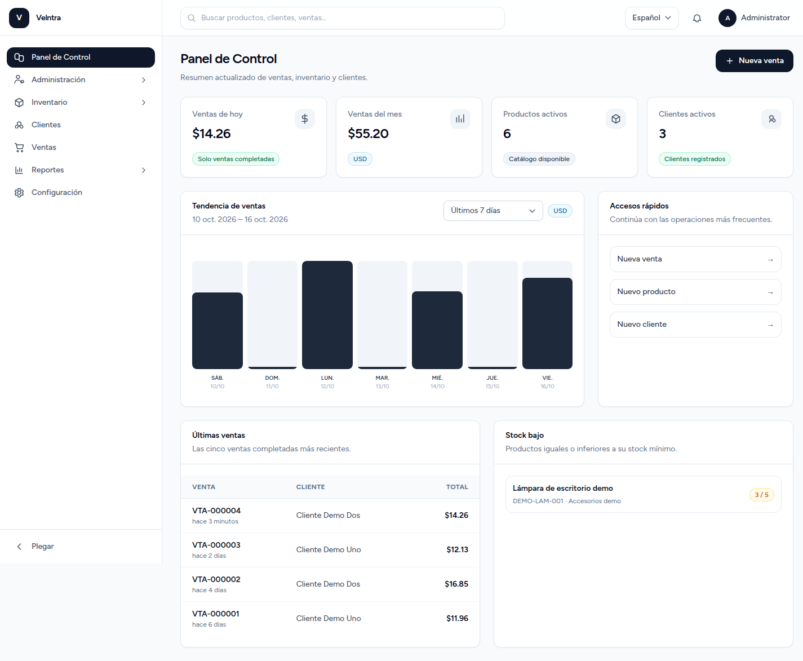

# Velntra

Sistema web de inventario y punto de venta para un pequeño negocio de una sola sucursal. Permite gestionar productos, clientes y ventas, consultar indicadores y exportar reportes.

## Funcionalidades

- Administración interna de usuarios, roles y permisos; el registro público está deshabilitado.
- Categorías y productos con búsqueda, filtros, imágenes, stock mínimo y baja lógica.
- Clientes e historial de compras, incluido el Consumidor Final.
- POS con ventas completadas o en espera, descuentos, IVA, métodos de pago, tickets y anulación con restitución de stock.
- Dashboard con métricas reales y tendencia por períodos o rango personalizado.
- Reportes separados de ventas, inventario y clientes, exportables a Excel y PDF.
- Configuración de empresa, logo, moneda e IVA; interfaz en español e inglés.

El alcance de v1.0 es **una empresa y una sucursal**. No incluye facturación electrónica, multiempresa ni integración con pasarelas de pago.

## Capturas con datos ficticios



[Catálogo de productos](docs/screenshots/products.png) · [Punto de venta](docs/screenshots/pos.png) · [Reporte de ventas](docs/screenshots/reports.png) · [Historial móvil](docs/screenshots/sales-history-mobile.png)

## Tecnologías

Laravel 12 y PHP 8.3, Livewire 4, Blade y Tailwind CSS, MySQL 8, Vite y Docker Compose. El código Laravel está en [`src/`](src/); la infraestructura local, en [`docker/`](docker/) y [`docker-compose.yml`](docker-compose.yml).

## Inicio rápido con Docker

Desde la raíz del repositorio:

```bash
cp .env.example .env
cp src/.env.example src/.env
docker compose build app
docker compose run --rm --no-deps app composer install
docker compose run --rm --no-deps app php artisan key:generate
docker compose run --rm node npm ci
docker compose run --rm node npm run build
docker compose up -d
docker compose exec -T app php artisan storage:link
```

Abre `http://localhost:8000`. El arranque ejecuta las migraciones y los seeders estructurales de forma automática. Las credenciales iniciales de **desarrollo local** están en [`docs/installation.md`](docs/installation.md); cambia la contraseña antes de compartir un entorno. No uses la configuración Docker de desarrollo como despliegue público.

La [guía de instalación](docs/installation.md) explica variables, verificación y solución de problemas. Los datos ficticios para una demostración aislada están documentados en la [guía de demo](docs/demo.md) y **no** se cargan automáticamente en un negocio real.

## Verificación

```bash
docker compose exec -T app php artisan test --compact
docker compose run --rm node npm run build
```

La suite cubre el flujo de inventario, clientes, venta, descuento y restitución de stock, permisos, dashboard, reportes y exportaciones.

## Publicación

Consulta [`docs/deployment.md`](docs/deployment.md) antes de desplegar. El [texto para portafolio](docs/portfolio.md) y las capturas provienen de una base demo aislada, pero **todavía no hay URL pública ni hosting elegido**. El despliegue final y el video de demostración siguen pendientes.

## Estado

Los módulos del MVP y la validación funcional están completos. El avance de publicación se mantiene en [`StockFlow-plan/AI_PROGRESS.md`](StockFlow-plan/AI_PROGRESS.md).
